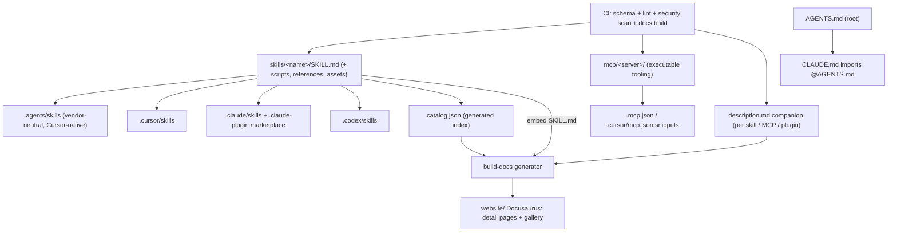

# Portable, Contributable Skills Repo

> Overview: Structure a GitHub repo that offers Claude-style skills, scripts, and MCP tooling in the vendor-neutral Agent Skills (SKILL.md) format, with thin per-harness adapters and CI gating so forks and PRs stay consumable by Cursor, Claude, Codex, Copilot, Windsurf, and other harnesses.

## Milestones / Todos

- [ ] **scaffold** - Initialize git repo and create top-level `skills/` and `mcp/` directories with one reference `SKILL.md` and one reference MCP server as templates.
- [ ] **schema** - Write JSON Schema for `SKILL.md` frontmatter and a validate script enforcing portability rules (name/description constraints, reserved words, link depth, size).
- [ ] **adapters** - Add adapter layer: `.agents/skills`, `.cursor/skills`, `.claude/skills`, `.codex/skills` symlinks plus `install.sh`/`install.ps1` copy fallback and a sync-adapters script.
- [ ] **claude-plugin** - Add `.claude-plugin/marketplace.json` and `plugin.json` so the repo installs via Claude Code `/plugin marketplace add`, bundling skills, hooks, and MCP servers.
- [ ] **agents-md** - Author root `AGENTS.md` and `CLAUDE.md` (`@AGENTS.md` import) covering usage and contribution conventions across harnesses.
- [ ] **catalog** - Add build-catalog script generating `catalog.json` index of skills and MCP servers for discovery.
- [ ] **docs-companion** - Define a per-item `description.md`/`docs.mdx` companion file (skills, MCP servers, plugin) with a validated Docusaurus frontmatter schema for detail-page metadata, embedding `SKILL.md` so instructions are not duplicated.
- [ ] **docusaurus-site** - Scaffold a `website/` Docusaurus app with a generator that emits per-skill/per-plugin detail pages plus a `catalog.json`-driven gallery/index with harness/tag/category filters.
- [ ] **ci-gating** - Add GitHub Actions CI: schema validation, markdown lint, security scan of scripts/MCP servers, MCP smoke tests, catalog drift check.
- [ ] **governance** - Add `CONTRIBUTING.md`, PR template, `CODEOWNERS`, and `LICENSE` to define the fork/PR contribution workflow.

## Core strategy: author once, adapt everywhere

Write every skill once in the **open Agent Skills format** (a `SKILL.md` folder with only `name` + `description` required in frontmatter). This single format is natively consumed by Cursor, Claude Code, Codex, Copilot, and VS Code today. Everything else (Claude plugin manifest, `AGENTS.md`, MCP config, per-tool symlinks) is a thin adapter layer generated from or pointing at that one source of truth. Executable capabilities that are more than instructions are exposed as **MCP servers** (the cross-harness tooling standard), not tool-specific plugin code.

## Proposed repo layout

- `skills/<skill-name>/SKILL.md` - canonical, spec-compliant source of truth (human-discoverable at repo top level). Optional `scripts/`, `references/`, `assets/` per skill.
- `skills/<skill-name>/description.md` - companion presentation file (see Docusaurus layer below) holding the extra detail-page content and metadata; keeps `SKILL.md` lean and portable.
- `mcp/<server-name>/` - executable tooling as MCP servers, each with its own README, runnable entrypoint, and a `description.md` companion.
- `.agents/skills/`, `.cursor/skills/`, `.claude/skills/`, `.codex/skills/` - adapters that expose `skills/` to each harness. Recommended: relative symlinks (zero-copy, git-tracked) with a copy-based fallback installer for Windows forks.
- `.claude-plugin/marketplace.json` (+ per-plugin `plugin.json`) - enables `/plugin marketplace add <owner>/<repo>` one-command install in Claude Code, bundling skills, hooks, and MCP servers.
- `AGENTS.md` (root) + `CLAUDE.md` (one line: `@AGENTS.md`) - cross-tool contributor/usage instructions.
- `catalog.json` - generated index of all skills and MCP servers for discovery (feeds both agents and the docs gallery).
- `website/` - Docusaurus app (its own `package.json`, `docusaurus.config.js`, `sidebars`, custom detail-page template, and gallery/index page).
- `scripts/` (repo-level): `install.sh` / `install.ps1` (place adapters into a target project), `build-catalog`, `sync-adapters`, `validate`, `build-docs`.
- Governance: `CONTRIBUTING.md`, `.github/PULL_REQUEST_TEMPLATE.md`, `CODEOWNERS`, `LICENSE`, `.github/workflows/ci.yml`, `.github/workflows/docs.yml` (build + deploy to GitHub Pages).

## Skill authoring conventions (portability rules)

- Keep frontmatter to the portable core: `name` (kebab-case, <=64 chars, matches folder, no `anthropic`/`claude`, no XML tags) and `description` (<=1024 chars, third person, states WHAT + WHEN). Put tool-specific keys (e.g. Cursor `paths`, Claude `allowed-tools`) only where needed; other runtimes ignore them.
- `SKILL.md` body under ~500 lines; use progressive disclosure to `references/` (one level deep).
- Anything requiring reliable execution goes in `scripts/` (invoked from the skill) or graduates to an `mcp/` server when it needs to run as a live tool across harnesses.

## Docusaurus documentation layer (detail page per skill / script / plugin)

The extra information Docusaurus renders lives in a **companion `description.md` file next to each `SKILL.md` / MCP server / plugin**, not inside `SKILL.md`. This keeps the agent-facing `SKILL.md` lean and portable while giving the site a rich, human-facing detail page. The companion file's YAML frontmatter carries the structured metadata; its body carries prose, screenshots, and examples. The site generator embeds the canonical `SKILL.md` (via MDX import / remark include) so instructions render on the detail page without being duplicated. Use `description.mdx` if the file needs JSX components (tabs, live compatibility matrix).

Proposed companion frontmatter schema (validated in CI, also merged into `catalog.json`):

- `title`, `sidebar_label`, `description` - presentation strings (may be richer/longer than the portable SKILL `description`).
- `type` - `skill` | `mcp-server` | `plugin`.
- `category` and `tags` / `keywords` - drive sidebar grouping and gallery filters.
- `harnesses` - list of `{ id, support }` (e.g. `cursor: native`, `claude: plugin`, `codex: native`, `copilot: native`, `windsurf: native`) rendered as a compatibility matrix.
- `version`, `author` / `maintainer`, `license`, `level` (beginner/intermediate/advanced).
- `requirements` - runtimes, packages, network/permissions the skill or MCP server needs.
- `install` - per-harness install snippets (symlink path, `/plugin marketplace add ...`, MCP config block).
- `usage` / `inputs` / `outputs` - what to invoke and what to expect.
- `media` - paths under the skill's `assets/` for screenshots or demo gifs shown on the page.
- `links` - source, issues, related skills.

Body conventions: Overview, When to use, How it works, Install (per harness, from `install`), Usage examples with media, Compatibility matrix (from `harnesses`), Changelog. A short template ships in the repo so contributors fill blanks consistently.

Site generation and presentation:

- `scripts/build-docs` walks `skills/` and `mcp/`, and for each item generates a page into `website/docs/skills/<name>.mdx` / `website/docs/mcp/<name>.mdx` (frontmatter from the companion file, body = companion prose + embedded `SKILL.md` + auto-rendered compatibility/install blocks from frontmatter).
- A custom React detail-page template renders the compatibility matrix, install tabs (one per harness), and media consistently.
- A `catalog.json`-driven **gallery/index page** lists all items as filterable cards (by harness, tag, category, level), so the site works as a browsable registry.
- `.github/workflows/docs.yml` builds the site and deploys to GitHub Pages on merge to main.

## Contribution gating (what makes PRs mergeable)

A GitHub Actions workflow is the merge gate. It should:

- Validate every `SKILL.md` against a JSON Schema (frontmatter rules above, folder/name match, reference links resolve and are one level deep, body size limits).
- Lint markdown and check for time-sensitive content / Windows paths.
- **Security-scan bundled `scripts/` and MCP servers** (this repo accepts community-contributed executable code, so static analysis + dependency audit is essential before merge).
- Validate MCP server manifests and run their smoke tests.
- Validate each companion `description.md` against the frontmatter schema (required fields, valid `harnesses`/`type` enums, media paths resolve) and run `docusaurus build` so a bad page fails the PR.
- Verify adapter/symlink consistency and regenerate `catalog.json`, failing if it drifts from committed state.
- `CODEOWNERS` requires maintainer review; PR template asks contributors which harnesses they validated against.

## Recommended decisions (chosen defaults, adjustable)

- Canonical location: top-level `skills/` for human discoverability, mirrored into tool dirs via committed relative symlinks + an installer fallback.
- Executable tooling: prefer MCP servers over per-tool plugin code so one implementation serves all harnesses.
- Claude gets the richest packaging (plugin marketplace) since it is the only harness with a first-class bundle/install mechanism; every other harness consumes the plain `skills/` tree or `AGENTS.md`.
