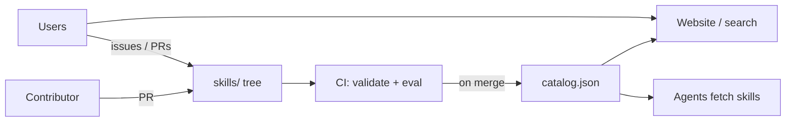
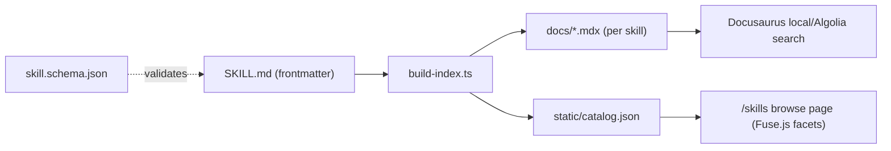

# tableau-skills: Open-Source Agent Skills Repo — Plan

An open-source catalog of modifiable "skills" that inform AI agents performing Tableau authoring, configuration, management, and administration. Users browse a website to gain skills; contributors PR new skills, modifications, and bug fixes; issues track requests and defects.

## Goals

The design optimizes for three things at once:

- Skills are easy for **agents to consume** programmatically.
- Skills are easy for **humans to author and PR**.
- The catalog is easy to **govern at scale** (many consumers, open contributor pool).

## 1. Atomic unit: a skill is a self-contained directory

Each skill is a folder (not a single file) so it can carry examples, references, scripts, and evals. Uses the emerging `SKILL.md` convention.

```
skills/
  authoring/
    create-calculated-field/
      SKILL.md            # frontmatter + instructions (the contract)
      examples/           # sample inputs/outputs, .twb snippets
      references/         # deep-dive docs loaded on demand
      scripts/            # optional helper scripts the agent can run
      eval/               # test cases that prove the skill works
```

### SKILL.md frontmatter (the machine-readable contract)

```yaml
---
id: authoring/create-calculated-field        # stable id; never changes
title: Create Calculated Field               # used by Docusaurus + site
description: Use when adding a calculated field to a worksheet or data source.
version: 1.2.0                               # SemVer per skill
categories: [authoring, calculations]        # facet 1 (enum-validated)
tableau_surface: [desktop, cloud, server]    # facet 2 (where it applies)
maturity: stable                             # experimental | beta | stable | deprecated
min_tableau_version: "2023.1"                # range facet
keywords: [calc, formula, LOD, computed field]  # search boost + synonyms
tags: [authoring, calculations]              # native Docusaurus tag pages (optional)
owners: ["@calc-wg"]                         # CODEOWNERS routing
requires_tools: [tableau-mcp]               # optional declared dependencies
superseded_by: null                          # set on deprecation, never hard-delete
---
```

Frontmatter powers discovery, the website index, validation, filtering, and routing — keep it strict and schema-validated.

## 2. Taxonomy by Tableau workflow (shallow, max 2 levels)

Top-level `skills/` categories map to what the agent is doing / how users think:

- `authoring/` — calcs, viz building, dashboards, parameters, LOD expressions
- `data-modeling/` — relationships, joins, data source design, extracts
- `configuration/` — site/server settings, permissions, projects
- `management/` — content migration, governance, certification, monitoring
- `administration/` — users/groups, licensing, Pulse, scheduling
- `analytics/` — forecasting, clustering, table calcs, analytics pane
- `troubleshooting/` — performance tuning, recovery, common errors

Keep the tree shallow; deep nesting kills discoverability for humans and agents.

## 3. Repo layout

```
tableau-skills/
  skills/                     # the catalog (above)
  schema/
    skill.schema.json         # JSON Schema for SKILL.md frontmatter (controlled vocab)
  scripts/
    validate.ts               # lint frontmatter, links, required sections
    build-index.ts            # generate catalog.json + per-skill MDX
    run-evals.ts              # execute each skill's eval/ cases
  catalog.json                # generated machine-readable index (the API)
  site/                       # Docusaurus website consuming catalog.json
  .github/
    ISSUE_TEMPLATE/
      bug.yml
      new-skill.yml
      skill-improvement.yml
    PULL_REQUEST_TEMPLATE/
      new-skill.md
    workflows/
      validate.yml            # CI: schema + lint + eval on every PR
    CODEOWNERS
  CONTRIBUTING.md
  GOVERNANCE.md
  SKILL_AUTHORING_GUIDE.md
```

Key architectural move: **`catalog.json` is the product's API.** Agents and the website consume the generated index, never crawl the raw tree. CI regenerates and validates it on every merge.



## 4. Governance and contribution flow

- **CODEOWNERS by domain.** `skills/authoring/**` -> `@authoring-wg`. Auto-routes review; avoids a single bottleneck maintainer.
- **Three issue templates** matching the three flows: new skill, modification/improvement, bug. Bug template requires Tableau surface, version, skill id, and a reproducible prompt/transcript.
- **CI gates every PR**: frontmatter schema validation, dead-link check, required-section check, and `eval/` execution. A skill cannot merge without at least one passing eval case.
- **Maturity lifecycle** in frontmatter (`experimental -> beta -> stable -> deprecated`). Deprecation is a metadata change + `superseded_by`, never a hard delete (avoids breaking pinned consumers).
- **Versioning**: SemVer per skill; tag repo releases so consumers can pin a known-good catalog snapshot.

## 5. Making skills agent-consumable

- **Progressive disclosure**: `SKILL.md` stays short (when + how); heavy detail in `references/` loaded on demand. Keeps agent context lean.
- **Stable IDs** are the contract agents pin to (path can move, id cannot).
- **Declared applicability** (`tableau_surface`, `min_tableau_version`, `requires_tools`) lets a runtime filter to only relevant skills before injecting them.
- A thin `@tableau/skills` npm package (or raw `catalog.json` via CDN/GitHub raw) gives agents a clean fetch path.

## 6. Metadata-driven filtering + search on the Docusaurus site

Author metadata once in frontmatter; a build step fans it out into two consumers: real Docusaurus doc pages (SEO, deep links, global search) and a single generated `catalog.json` that powers a custom faceted-browse page.



### 6a. Controlled vocabulary enforced in CI

`schema/skill.schema.json` pins `categories`, `tableau_surface`, and `maturity` to enums. CI rejects any PR that invents a new facet value without updating the schema — this keeps facets coherent across community contributions (avoids "calc" vs "calcs" vs "calculation").

### 6b. Build step emits doc page + index

`scripts/build-index.ts` walks `skills/**/SKILL.md`, parses frontmatter (e.g. `gray-matter`), and writes:

- `docs/<id>.mdx` per skill -> normal Docusaurus page (global search, permalinks, tag pages for free).
- Flat `static/catalog.json` array -> the API for the browse page:

```json
[
  {
    "id": "authoring/create-calculated-field",
    "title": "Create Calculated Field",
    "description": "Use when adding a calculated field...",
    "categories": ["authoring", "calculations"],
    "tableau_surface": ["desktop", "cloud", "server"],
    "maturity": "stable",
    "min_tableau_version": "2023.1",
    "keywords": ["calc", "formula", "LOD"],
    "permalink": "/docs/authoring/create-calculated-field"
  }
]
```

Run it from `docusaurus.config.ts` via a small plugin's `loadContent`/`contentLoaded` hook (or a `prebuild` npm script) so JSON is regenerated before every build.

### 6c. Faceted browse page (dynamic filtering)

Custom page `site/src/pages/skills.tsx` imports the static index and does client-side faceting + fuzzy search with Fuse.js:

```tsx
import catalog from '@site/static/catalog.json';
import Fuse from 'fuse.js';
import { useMemo, useState } from 'react';

const fuse = new Fuse(catalog, {
  keys: ['title', 'description', 'keywords', 'categories'],
  threshold: 0.35,
});

export default function Skills() {
  const [q, setQ] = useState('');
  const [cats, setCats] = useState<string[]>([]);
  const [surface, setSurface] = useState<string[]>([]);

  const results = useMemo(() => {
    let rows = q ? fuse.search(q).map((r) => r.item) : catalog;
    if (cats.length) rows = rows.filter((r) => cats.every((c) => r.categories.includes(c)));
    if (surface.length) rows = rows.filter((r) => surface.some((s) => r.tableau_surface.includes(s)));
    return rows;
  }, [q, cats, surface]);

  // render: search box + facet checkbox groups (derived from catalog) + result cards
}
```

Polish details:

- **Derive facet options from the catalog itself** (`[...new Set(catalog.flatMap(c => c.categories))]`) so new categories appear automatically after merge — no UI change per skill.
- **Sync state to URL query string** (`?categories=authoring&q=lod`) so filtered views are shareable/bookmarkable and agents can deep-link.

### 6d. Keyword search — two complementary layers

- **Global site search** over full page bodies: `@easyops-cn/docusaurus-search-local` (offline, zero-infra, good for OSS) or Algolia DocSearch (free for OSS, better relevance).
- **Browse-page search** (Fuse.js) scoped to the metadata index for fast facet-aware filtering.
- Frontmatter `keywords` feed both (Docusaurus indexes them; Fuse weights them) — put synonyms here ("computed field", "LOD") so natural phrasing still hits.

### 6e. Free wins from native Docusaurus tags

Setting `tags:` in frontmatter auto-generates `/docs/tags/<tag>` category landing pages with no custom code — complements the richer `/skills` faceted browser.

## 7. Quality and trust at scale

- **Evals as first-class.** Each skill ships test cases; CI runs them; the site shows a "verified" badge. Biggest differentiator vs. a prose wiki.
- **Opt-in feedback.** A per-skill feedback link on the site auto-files an improvement issue with the skill id prefilled.
- **Working groups** (`GOVERNANCE.md`) own domains, triage issues, and set the bar for promotion to `stable`.

## Open decisions

- Tooling stack for scripts/build: Node/TypeScript (matches Tableau MCP ecosystem) vs Python.
- Local search plugin vs Algolia DocSearch.
- Whether to publish a thin `@tableau/skills` npm package or serve raw `catalog.json`.

## Suggested first scaffold (when approved)

`skill.schema.json`, one sample skill folder (`authoring/create-calculated-field/`), `scripts/validate.ts` + `scripts/build-index.ts`, issue/PR templates, `validate.yml` CI workflow, and a minimal Docusaurus `site/` with the `/skills` faceted page.
